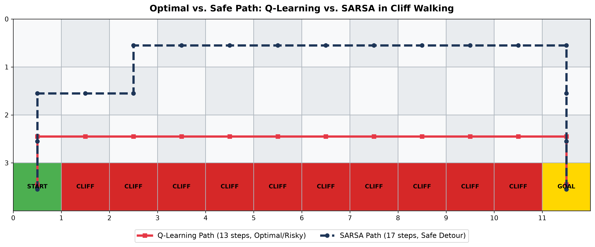
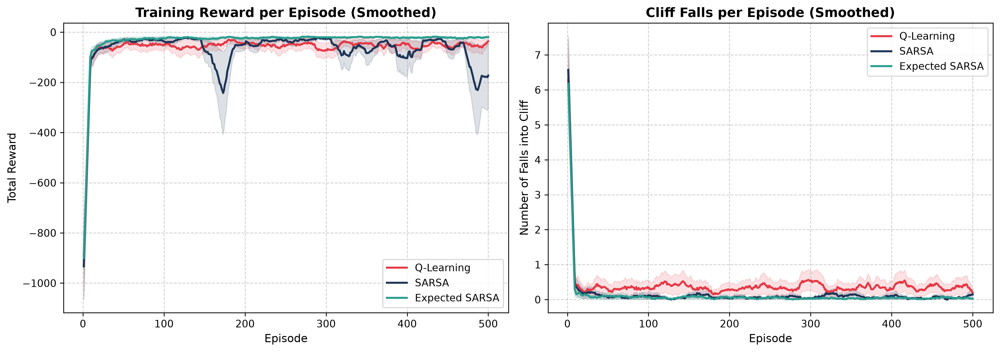
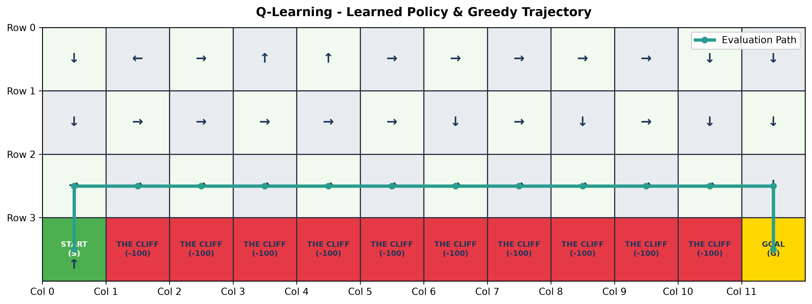
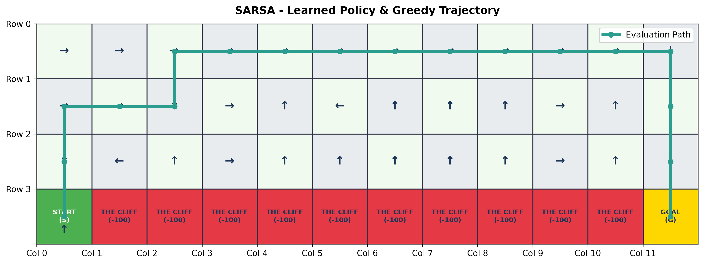

# CliffWalking-RL: On-Policy (SARSA) vs. Off-Policy (Q-Learning) Benchmark

[](https://www.python.org/)
[](https://gymnasium.farama.org/)
[](https://opensource.org/licenses/MIT)
[]()

A clean, modular reinforcement learning benchmark implementing and comparing **Q-Learning** (Off-Policy TD Control), **SARSA** (On-Policy TD Control), and **Expected SARSA** on Farama Gymnasium's [`CliffWalking-v1`](https://gymnasium.farama.org/environments/toy_text/cliff_walking/) environment.

---

## 📌 The Problem: The Cliff Walking Dilemma

In reinforcement learning, the **Cliff Walking** task (Sutton & Barto, *Reinforcement Learning: An Introduction*, Example 6.6) illustrates the fundamental divergence between **on-policy** and **off-policy** temporal-difference (TD) methods.

```text
+---+---+---+---+---+---+---+---+---+---+---+---+
| 0 | 1 | 2 | 3 | 4 | 5 | 6 | 7 | 8 | 9 |10 |11 |  (Row 0: Safe detour route)
+---+---+---+---+---+---+---+---+---+---+---+---+
|12 |13 |14 |15 |16 |17 |18 |19 |20 |21 |22 |23 |  (Row 1: Upper transit)
+---+---+---+---+---+---+---+---+---+---+---+---+
|24 |25 |26 |27 |28 |29 |30 |31 |32 |33 |34 |35 |  (Row 2: Cliff edge - Optimal but Risky)
+---+---+---+---+---+---+---+---+---+---+---+---+
| S | C | C | C | C | C | C | C | C | C | C | G |  (Row 3: Start, Cliff [-100], Goal)
+---+---+---+---+---+---+---+---+---+---+---+---+
 36  37  38  39  40  41  42  43  44  45  46  47
```

* **Grid**: $4 \times 12$ grid ($48$ discrete states).
* **Start (S)**: State $36$ (bottom-left).
* **Goal (G)**: State $47$ (bottom-right).
* **The Cliff (C)**: States $37$ through $46$. Stepping into the cliff yields **$-100$ reward** and sends the agent back to the start.
* **Standard Transition**: **$-1$ reward** per step.

---

## 🧠 Algorithmic Differences: Why Do the Paths Diverge?

### 1. Q-Learning (Off-Policy TD Control)
* **Update Target**: $R_{t+1} + \gamma \max_{a} Q(S_{t+1}, a)$
* **Target Policy**: Pure Greedy ($\pi^*$).
* **Behavior Policy**: $\epsilon$-greedy.
* **Insight**: Q-learning evaluates state-action pairs assuming the agent will act *optimally* from the next state onward ($\max_a Q$). It completely ignores the fact that its $\epsilon$-greedy exploratory policy occasionally takes random actions. 
* **Outcome**: It learns the **optimal path** directly along the cliff edge (Row 2), achieving an evaluation return of **$-13$** ($13$ steps). However, during training, exploratory steps frequently toss it into the abyss, leading to poor online training performance.

### 2. SARSA (On-Policy TD Control)
* **Update Target**: $R_{t+1} + \gamma Q(S_{t+1}, A_{t+1})$
* **Target Policy**: Same $\epsilon$-greedy policy as behavior.
* **Behavior Policy**: $\epsilon$-greedy.
* **Insight**: SARSA evaluates the policy it actually executes. Because exploratory missteps occur with probability $\epsilon$, states right along the cliff edge carry a significant expected penalty. SARSA learns that the cliff edge is dangerous *under its exploration policy*.
* **Outcome**: It learns a **safer detour path** through the upper rows (Row 0 / Row 1), achieving an evaluation return of **$-17$** ($17$ steps). During training, it incurs far fewer catastrophic falls.

---

## 📐 Mathematical Formulation

| Algorithm | Temporal Difference Target ($y_t$) | Update Equation |
| :--- | :--- | :--- |
| **Q-Learning** | $R_{t+1} + \gamma \max_{a} Q(S_{t+1}, a)$ | $Q(S_t, A_t) \leftarrow Q(S_t, A_t) + \alpha [y_t - Q(S_t, A_t)]$ |
| **SARSA** | $R_{t+1} + \gamma Q(S_{t+1}, A_{t+1})$ | $Q(S_t, A_t) \leftarrow Q(S_t, A_t) + \alpha [y_t - Q(S_t, A_t)]$ |
| **Expected SARSA** | $R_{t+1} + \gamma \sum_a \pi(a \mid S_{t+1}) Q(S_{t+1}, a)$ | $Q(S_t, A_t) \leftarrow Q(S_t, A_t) + \alpha [y_t - Q(S_t, A_t)]$ |

---

## 📊 Benchmark Summary

| Algorithm | Control Paradigm | Optimal Path Return | Steps to Goal | Safety Level | Online Training Stability |
| :--- | :--- | :---: | :---: | :--- | :--- |
| **Q-Learning** | Off-Policy | **$-13$** | **$13$** | High Risk (Cliff Edge) | High variance (frequent $-100$ penalties) |
| **SARSA** | On-Policy | **$-17$** | **$17$** | Safe (Upper Detour) | Low variance (fast convergence to safety) |
| **Expected SARSA** | Off/On-Policy | **$-13$** | **$13$** | Balanced | Smoothest gradient (reduced sampling variance) |

---

## 📈 Visualizations & Empirical Results

### 1. Optimal vs. Safe Path Comparison
Q-Learning takes the razor-thin, minimum-step route along row 2 directly adjacent to the cliff (-13 reward). In contrast, SARSA selects the conservative loop through row 0 (-17 reward) to avoid catastrophic drops triggered by $\epsilon$-exploration.



### 2. Learning Curves & Cliff Falls
Comparison of mean episodic rewards and cliff falls across 5 independent seeds (with moving average smoothing and standard error bands):



### 3. Policy Vector Fields & Evaluation Trajectories

| Q-Learning (Risky Edge Trajectory) | SARSA (Upper Detour Trajectory) |
| :---: | :---: |
|  |  |

---

## 📂 Repository Structure

```text
CliffWalking-RL/
├── src/
│   ├── __init__.py           # Package exports
│   ├── agents.py             # BaseAgent, QLearningAgent, SARSAAgent, ExpectedSARSAAgent
│   ├── environment.py        # Grid constants, coordinates, and Gymnasium factory
│   ├── trainer.py            # Training loop, evaluation, and multi-seed benchmarking
│   └── visualizer.py         # Matplotlib policy maps, trajectory lines, and curves
├── notebooks/
│   ├── 01_q_learning.ipynb   # Interactive Q-learning walkthrough
│   └── 02_sarsa.ipynb        # Interactive SARSA walkthrough
├── assets/                   # Generated benchmark plots & policy diagrams
├── main.py                   # Unified CLI entry point
├── requirements.txt          # Python dependencies
├── .gitignore                # Git ignore rules
├── LICENSE                   # MIT License
└── README.md                 # Project documentation
```

---

## 🚀 Quick Start

### 1. Clone & Set Up Virtual Environment

```bash
git clone https://github.com/your-username/CliffWalking-RL.git
cd CliffWalking-RL

python3 -m venv .venv
source .venv/bin/activate  # On Windows: .venv\Scripts\activate
pip install -r requirements.txt
```

### 2. Run Benchmarks & Generate Plots

Run the complete multi-seed statistical benchmark across all algorithms:

```bash
python main.py --compare --episodes 500 --runs 5
```

This will output ASCII policy maps and save high-resolution plots to `assets/`:
* `assets/learning_curves.png`: Side-by-side episodic reward and cliff falls comparison.
* `assets/path_comparison.png`: Dual trajectory overlay (Optimal vs. Safe).
* `assets/q_learning_policy.png`: Learned policy arrows and greedy trajectory for Q-Learning.
* `assets/sarsa_policy.png`: Learned policy arrows and greedy trajectory for SARSA.

### 3. Train Individual Agents

Train only SARSA with custom hyperparameters:
```bash
python main.py --algo sarsa --episodes 600 --alpha 0.4 --gamma 0.95
```

### 4. Visual Rendering in Pygame GUI

Watch the trained agent navigate the cliff in a live graphical window:
```bash
python main.py --algo q_learning --render
```

---

## 🔬 Interactive Jupyter Notebooks

If you prefer exploring step-by-step:
* Open [`notebooks/01_q_learning.ipynb`](file:///Users/swapnil/Desktop/Projects/CliffWalkingProblem/notebooks/01_q_learning.ipynb) for a detailed Q-Learning walkthrough.
* Open [`notebooks/02_sarsa.ipynb`](file:///Users/swapnil/Desktop/Projects/CliffWalkingProblem/notebooks/02_sarsa.ipynb) for the SARSA analysis and corrected TD error update.

---

## 📜 References
* Sutton, R. S., & Barto, A. G. (2018). *Reinforcement Learning: An Introduction* (2nd ed.). MIT Press. Chapter 6: Temporal-Difference Learning.
* Farama Foundation Gymnasium: [Cliff Walking Documentation](https://gymnasium.farama.org/environments/toy_text/cliff_walking/).
* Watkins, C. J. C. H. (1989). *Learning from Delayed Rewards*. Ph.D. thesis, University of Cambridge.
* Rummery, G. A., & Niranjan, M. (1994). *On-line Q-learning using connectionist systems*. University of Cambridge.

---

## 📄 License
This project is open-source under the [MIT License](LICENSE).
